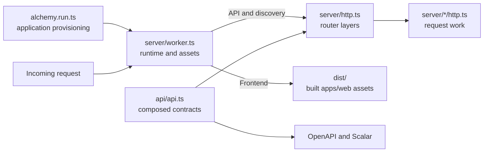

# Onboarding

This guide is the starting point for humans and agents working in the template. It explains where behavior belongs, which files establish contracts, and how to choose supported capabilities before writing custom machinery. Agents additionally follow [AGENTS.md](../AGENTS.md); task-specific details live in the [documentation index](README.md).

## What you are looking at

This is a Bun monorepo centered on an Effect HTTP API hosted in an Alchemy Cloudflare Worker, with a replaceable frontend scaffold in `apps/web`. The root application stack provisions that Worker and optional GitHub preview comments. Database, authentication, and application storage are deliberate future choices; none is installed as an application feature. Preserve the versions pinned in [package.json](../package.json) and the lockfile.

The diagram below describes the current runtime wiring, including placeholder frontend assets; it does not prescribe the future frontend hosting or rendering model.

Alchemy owns infrastructure provisioning, resource state, bindings, and the Worker integration. Effect owns application composition, schemas, typed failures, services, and lifecycle. Cloudflare supplies the hosting runtime and platform resources. These responsibilities work together; infrastructure providers are distinct from layers that provide services while a request executes.



Worker construction assembles services and handlers; request work runs inside the HTTP effect. This follows [Alchemy's Effect HTTP API guide](https://alchemy.run/cloudflare/apis/effect-http-api/). The current platform stub is a documented pinned-version adaptation in `server/worker.ts`; inspect its contract before changing filesystem or response behavior.

## Temporary frontend

The current HTML frontend is a temporary scaffold. Its entry-file layout and static asset hosting do not establish lasting frontend requirements. Keep onboarding focused on the shared infrastructure and backend foundations. Follow the chosen framework's conventions when replacing the scaffold.

## Where to look

Paths below are relative to the repository root.

| Question                                                               | Owning source                                                                                                                                                             |
| ---------------------------------------------------------------------- | ------------------------------------------------------------------------------------------------------------------------------------------------------------------------- |
| What resources does the application deploy?                            | [alchemy.run.ts](../alchemy.run.ts)                                                                                                                                       |
| How is the Worker constructed, and how are assets and telemetry wired? | [apps/api/src/server/worker.ts](../apps/api/src/server/worker.ts)                                                                                                         |
| Which API contracts are exposed?                                       | [apps/api/src/api/api.ts](../apps/api/src/api/api.ts) and each group module in `apps/api/src/api/`                                                                        |
| Where are handler layers and API documentation registered?             | [apps/api/src/server/http.ts](../apps/api/src/server/http.ts)                                                                                                             |
| Where does request behavior belong?                                    | `apps/api/src/server/<group>/http.ts`; start with [healthz](../apps/api/src/server/healthz/http.ts)                                                                       |
| Where do concrete runtime integrations belong?                         | `apps/api/src/platform/`; [validation](../apps/api/src/platform/http/validation/middleware.ts) is the existing HTTP boundary                                              |
| Where are documentation route paths shared?                            | [apps/api/src/api/documentation.ts](../apps/api/src/api/documentation.ts)                                                                                                 |
| Where is frontend source?                                              | [apps/web/src/main.ts](../apps/web/src/main.ts) and [index.html](../index.html)                                                                                           |
| Where are identity and deployment stages defined?                      | [infra/config/project.ts](../infra/config/project.ts) and [stages.ts](../infra/config/stages.ts)                                                                          |
| Which stack creates GitHub deployment credentials?                     | [infra/stacks/github.ts](../infra/stacks/github.ts); a separate admin operation                                                                                           |
| Which stack owns disposable cloud-test resources?                      | [infra/stacks/integration.ts](../infra/stacks/integration.ts)                                                                                                             |
| Where are local and cloud tests?                                       | [apps/api/tests/worker.test.ts](../apps/api/tests/worker.test.ts), focused colocated tests, and [test/integration.test.ts](../test/integration.test.ts)                   |
| Where are CI decisions and custom lint rules?                          | [.github/workflows/deploy.yml](../.github/workflows/deploy.yml), [tools/ci/deployment-stage.ts](../tools/ci/deployment-stage.ts), and [vite.config.ts](../vite.config.ts) |

TypeScript uses `@api/*`, `@server/*`, `@platform/*`, `@infra/*`, `@test/*`, and `@stack` aliases, including sibling imports. Use `bun run alchemy` for Alchemy commands so its launcher resolves the project's aliases. See [configuration and imports](alchemy/configuration.md).

## First local pass

Use the pinned Bun version declared by `packageManager` in `package.json`. From the repository root:

```sh
bun install --frozen-lockfile
bun run check
bun run build
bun test apps infra
```

These checks do not deploy cloud resources. `check` runs formatting, lint, and TypeScript; `build` builds frontend assets; local tests start the actual Worker in workerd with isolated local state and automatic cleanup. Build before Worker tests so assets are current. Focused boundary tests cover validation and configuration without deploying infrastructure.

Use `bun run dev:web` for frontend-only development. `bun run dev` uses the application stack and Cloudflare-hosted Alchemy state; account setup and initial state bootstrap may be required. It is a separate operation from the account-free test stack. Follow the [Cloudflare guide](alchemy/cloudflare/README.md) before account or infrastructure operations.

Cloud integration tests are explicitly invoked with `ALCHEMY_TEST_STAGE=test-…` and use a dedicated stack. Teardown runs locally and in CI. Read [testing and recovery](alchemy/cloudflare/testing.md) before running them; do not test against application production or preview stages. The [CI guide](alchemy/cloudflare/ci-cd.md) explains when configured credentials enable integration tests and deployment.

## Choose native capabilities before implementing

Start with the required behavior and guarantees, then inspect supported APIs. Use the [Effect design skill's native-capability review](../.agents/skills/effect-design/SKILL.md) before implementing a nontrivial operation. It is the owning review procedure for both humans and agents.

| Work being added                                                  | First capabilities to inspect                                                   |
| ----------------------------------------------------------------- | ------------------------------------------------------------------------------- |
| Provisioning, resource bindings, runtime clients, local emulation | Alchemy's relevant Cloudflare guide and installed resource/provider integration |
| Streams, multipart, body consumption, bounded collection          | Effect `Stream`, `Sink`, `Channel`, and `effect/http` body/multipart APIs       |
| Service dependencies and composition                              | Effect `Context.Service`, `Layer`, and supported platform layers                |
| Cancellation and cleanup                                          | Effect `Scope` and acquire/release APIs                                         |
| HTTP clients and schema-backed endpoints                          | Effect `HttpClient`, `HttpApi`, and Alchemy's Worker integration                |
| Parsing and configuration                                         | Effect `Schema`, `Config`, and `ConfigProvider`                                 |
| Concurrency, retries, coordination                                | Effect bounded concurrency, `Schedule`, `Queue`, and `PubSub`                   |
| Platform behavior without a supported integration                 | Cloudflare's native API with a small, documented Effect adaptation              |

Read [Alchemy's reference index](alchemy/cloudflare/README.md) and the task's upstream guide. For Effect, read installed `node_modules/effect/AGENTS.md`, follow its relevant examples, and inspect `node_modules/effect/src` for the pinned API. Check companion integrations and neighboring modules too. Current online documentation can describe newer releases; installed types and source settle compatibility with this checkout.

Prefer a supported Alchemy resource or client over recreating its provisioning or binding machinery. Prefer Effect's libraries over hand-written stream readers, dependency containers, retry loops, or finalizer registries when they meet the contract. A simpler supported implementation should replace custom equivalents; preserve streaming limits, cancellation, error channels, and resource lifetime while doing so. Do not add tutorial resources or dependencies without a chosen application requirement.

When custom glue is necessary, record the actual gap and the evidence checked at its owning boundary. Include a brief native-capability rationale in the implementation handoff so reviewers do not have to ask whether the supported approach was considered. One failed search or an unfamiliar API is not evidence that a native capability is missing.

## Make a focused change

1. Read the owning source, relevant guide, and applicable repo-local skills before editing. Follow definitions through imports and providers to understand the behavior being changed.
2. Establish schema meaning, data preservation, and compatibility requirements. Keep contracts in `api/`, handlers and Worker assembly in `server/`, and concrete integrations in `platform/`.
3. Keep public contracts in `api/` declarations. OpenAPI and Scalar derive from them; `llms.txt` is discovery. See [API documentation](alchemy/cloudflare/api-documentation.md) and [validation](alchemy/cloudflare/validation.md).
4. Trace meaningful internal operations and log useful decisions and causes. Use the [observability skill](../.agents/skills/trace-effect/SKILL.md); do not generate tests for every span or log.
5. Run the relevant behavior checks and normal hygiene commands. Keep commits atomic with the [commit skill](../.agents/skills/conventional-commits/SKILL.md), and follow the user's review and publishing instructions.

Keep this map current when ownership or workflows change. Update the owning focused guide for details rather than copying contracts into several documents.
